# 動作確認ノートブックの実行結果

[01_decoder_tour.ipynb](01_decoder_tour.ipynb) を **全セル実行したときの出力を、そのまま** 載せたもの（文字は原文のまま、図は画像として書き出し）。
ノートブック本体は出力を消してコミットしているため、実行せずに結果だけ確認したいときはここを見る。

- 実行日: 2026-10-25 / カーネル: `beachball_decoder (.venv)`（Python 3.14・numpy・matplotlib・obspy）
- 図の画像は [images/](images/)。コードは各セルの「コード」を開くと見られる。
- 実行方法: `.venv/bin/python -m jupyter nbconvert --to notebook --execute notebooks/01_decoder_tour.ipynb`（または VS Code で全セル実行）
- スライダー付きのセル（3-2・3-3・7）は、**スライダーの初期値で描いた状態** を載せている。

## 気象庁の解説より（要約）

震源球（発震機構解）の基本を、気象庁の解説ページから要約する。詳しくは各リンクの原典を参照。

- **発震機構解とは**: P波の初動が「押し」か「引き」かの分布から、地下で断層がどの向きに、どうずれたかを推定したもの。震源の真下の半球（下半球）に押し・引きを投影して図にする。 → [発震機構解とは何か](https://www.data.jma.go.jp/eqev/data/mech/kaisetu/mechkaisetu.html)
- **2つの節面**: 押しと引きの境目は直交する2つの面（節面）になる。地震は「押す力」と「引く力」の直交する2組で起こると考え、力の向きは節面と約45°をなす。
- **断層面はどちらか**: 節面のうち実際の断層面はどちらか、初動だけでは決められない。余震の分布や地殻変動の調査で判断する。 → [発震機構解と断層面](https://www.data.jma.go.jp/eqev/data/mech/kaisetu/mechkaisetu2.html)
- **断層のタイプ**: 正断層（上盤がずり下がる）・逆断層（上盤がのし上がる）・横ずれ断層（水平にずれる。相手側が右へ動けば右横ずれ）。模式図: [逆断層](https://www.data.jma.go.jp/eqev/data/mech/kaisetu/model_gyaku.html)・[正断層](https://www.data.jma.go.jp/eqev/data/mech/kaisetu/model_sei.html)・[横ずれ断層](https://www.data.jma.go.jp/eqev/data/mech/kaisetu/model_yoko.html)
- **P軸・T軸の位置**: 気象庁の図でも、引く力のT軸は「押し」の領域に、押す力のP軸は「引き」の領域にある（名前と領域が逆）。このノートブックの図と同じ関係。
- **CMT解との違い**: 初動解は破壊が始まった点の機構、CMT解は断層運動全体を1つの機構で代表させた解。同じ地震でも結果が異なることがある。 → [ＣＭＴ解とは何か](https://www.data.jma.go.jp/eqev/data/mech/kaisetu/cmt_kaisetu.html)

出典: 気象庁「発震機構解」解説ページ

## 1. 準備

<details><summary>コード</summary>

```python
import io
import sys
from pathlib import Path

import matplotlib.pyplot as plt
import numpy as np
from IPython.display import Image, display

sys.path.insert(0, str(Path.cwd().parent))  # notebooks/ から実行しても import できるように
import importlib

import beachball_decoder.fault as _fault
import beachball_decoder.render as _render

# コードを更新した直後でも、カーネルを再起動せずに最新版を読み込む
importlib.reload(_fault)
importlib.reload(_render)
from beachball_decoder import fault, render, from_sdr, from_mt_use

render.setup_font()


def show(fig, dpi=90):
    """図をPNGにして表示する（描画モジュールはAggバックエンド固定のため）。"""
    buf = io.BytesIO()
    fig.savefig(buf, format="png", dpi=dpi, bbox_inches="tight", facecolor="white")
    plt.close(fig)
    display(Image(buf.getvalue()))
```

</details>

## 2. 数式の確認

走向・傾斜・すべり角から、**もう一方の節面（補助面）**・モーメントテンソル・P軸/T軸を求める。
確認すること:
- 補助面が obspy の `aux_plane` と一致する
- 2つの節面から作ったテンソルが同じになる（＝図は同じ。どちらが断層面かは図から分からない）
- 逆断層では T軸が鉛直、正断層では P軸が鉛直

<details><summary>コード</summary>

```python
from obspy.imaging.beachball import aux_plane as obspy_aux_plane

cases = {"逆断層": (30, 45, 90), "正断層": (30, 60, -90), "左横ずれ": (45, 90, 0), "斜めずれ": (123, 35, 40)}
print(f"{'種類':<8}{'節面A':<24}{'節面B（自作）':<26}{'節面B（obspy）':<26}同じテンソル")
for name, sdr in cases.items():
    mine = fault.aux_plane(*sdr)
    ref = obspy_aux_plane(*sdr)
    same_tensor = np.allclose(fault.moment_tensor(*sdr), fault.moment_tensor(*mine))
    f = lambda t: f"{t[0]:6.1f} {t[1]:5.1f} {t[2]:7.1f}"
    print(f"{name:<8}{f(sdr):<24}{f(mine):<26}{f(ref):<26}{same_tensor}")
```

</details>

**実行結果**

```text
種類      節面A                     節面B（自作）                   節面B（obspy）                同じテンソル
逆断層       30.0  45.0    90.0     210.0  45.0    90.0       210.0  45.0    90.0      True
正断層       30.0  60.0   -90.0     210.0  30.0   -90.0       210.0  30.0   -90.0      True
左横ずれ      45.0  90.0     0.0     315.0  90.0   180.0       315.0  90.0  -180.0      True
斜めずれ     123.0  35.0    40.0     358.5  68.4   118.2       358.5  68.4   118.2      True
```

<details><summary>コード</summary>

```python
for name, sdr in cases.items():
    m = from_sdr(*sdr)
    print(f"■ {name}  → 判定: {m.fault_type[0]}")
    print(f"   P軸 方位{m.p_axis[0]:5.1f}° 沈み込み{m.p_axis[1]:5.1f}° / T軸 方位{m.t_axis[0]:5.1f}° 沈み込み{m.t_axis[1]:5.1f}°")
```

</details>

**実行結果**

```text
■ 逆断層  → 判定: 逆断層
   P軸 方位300.0° 沈み込み  0.0° / T軸 方位139.1° 沈み込み 90.0°
■ 正断層  → 判定: 正断層
   P軸 方位300.0° 沈み込み 75.0° / T軸 方位120.0° 沈み込み 15.0°
■ 左横ずれ  → 判定: 左横ずれ断層
   P軸 方位360.0° 沈み込み  0.0° / T軸 方位270.0° 沈み込み  0.0°
■ 斜めずれ  → 判定: 左横ずれ成分を伴う逆断層
   P軸 方位 67.9° 沈み込み 18.6° / T軸 方位306.5° 沈み込み 57.1°
```

## 3. 震源球の描画

下半球・等面積投影。**黒＝押し、白＝引き**。赤線が2本の節面（A・B）、青丸がP軸・T軸。
確認すること:
- 逆断層は**中心が黒**、正断層は**中心が白**
- T軸は黒い領域の中、P軸は白い領域の中にある（名前と色が逆）
- 横ずれ断層は節面が直線で、4象限が市松模様になる

<details><summary>コード</summary>

```python
presets = {"逆断層": (30, 45, 90), "正断層": (30, 60, -90), "左横ずれ": (45, 90, 0), "右横ずれ": (45, 90, 180), "斜めずれ": (30, 60, 45)}
fig, axes = plt.subplots(1, 5, figsize=(20, 4.6))
for ax, (name, sdr) in zip(axes, presets.items()):
    render.draw_beachball(ax, from_sdr(*sdr))
    ax.set_title(f"{name}\n走向{sdr[0]} 傾斜{sdr[1]} すべり角{sdr[2]}", fontsize=11)
show(fig)
```

</details>

**実行結果**

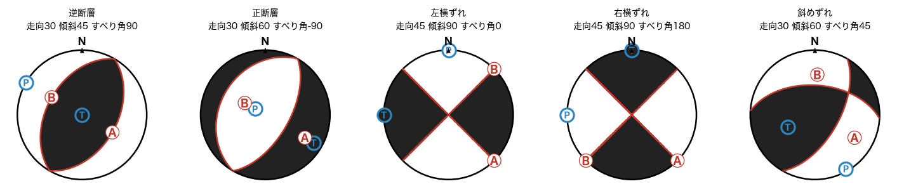

### 3-1. obspy の震源球との重ね合わせ

obspy の描画（黒＝押し）と自作の黒白が一致するかを画素で数える。節面のすぐ近くは多角形近似で数画素ずれるため除く。

<details><summary>コード</summary>

```python
from obspy.imaging.beachball import beach

def compare_with_obspy(sdr):
    mech = from_sdr(*sdr)
    fig = plt.figure(figsize=(4, 4), dpi=100)
    ax = fig.add_axes([0, 0, 1, 1])
    ax.add_collection(beach(list(fault.ned_to_use(mech.moment)), xy=(0, 0), width=200, facecolor="k", bgcolor="w", linewidth=0))
    ax.set_xlim(-110, 110); ax.set_ylim(-110, 110); ax.axis("off")
    fig.canvas.draw()
    img = np.asarray(fig.canvas.buffer_rgba())[..., 0]
    plt.close(fig)
    h, w = img.shape
    ok = total = 0
    for x in np.linspace(-0.9, 0.9, 19):
        for y in np.linspace(-0.9, 0.9, 19):
            if np.hypot(x, y) > 0.9:
                continue
            rho = np.hypot(x, y)
            v = render._pressure(mech.moment, np.arctan2(x, y), 2 * np.arcsin(rho / np.sqrt(2)))
            if abs(v) < 0.25:
                continue
            dark = img[int((110 - y * 100) / 220 * h), int((x * 100 + 110) / 220 * w)] < 128
            total += 1
            ok += dark == (v > 0)
    return ok, total

for name, sdr in presets.items():
    ok, total = compare_with_obspy(sdr)
    print(f"{name:<6} 一致 {ok}/{total}")
```

</details>

**実行結果**

```text
逆断層    一致 165/165
正断層    一致 164/164
左横ずれ   一致 160/160
右横ずれ   一致 160/160
斜めずれ   一致 161/161
```

### 3-2. 下半球を立体のお椀として見る

平らな震源球は「球の下半分（お椀）を真上から見た図」。そのお椀を**斜めから見たらどう見えるか**を描く。
- 左: 真上に近い視点（平らな震源球にいちばん近い）
- 中・右: 斜めから見るほど、色の境目（赤線）が球面に張りついている様子が分かる
- 一番右: お椀を**下から**見た外側（平らな図とは左右が鏡像になる）

確認すること: 赤線（節面）は球面を一周する大円で、お椀を横切る部分だけが見える。T軸（黒い領域の中）・P軸（白い領域の中）の青丸も球面上にある。

<details><summary>コード</summary>

```python
mech = from_sdr(*presets["逆断層"])
views = [(80, True, "真上に近い"), (55, True, "斜め上（55°）"), (30, True, "低い斜め上（30°）"), (-35, False, "下から（外側）")]
fig = plt.figure(figsize=(20, 5.5))
for i, (el, ins, label) in enumerate(views):
    ax = fig.add_subplot(1, 4, i + 1, projection="3d")
    render.draw_hemisphere(ax, mech, elev=el, inside=ins)
    ax.set_title(label, fontsize=13)
show(fig)
```

</details>

**実行結果**

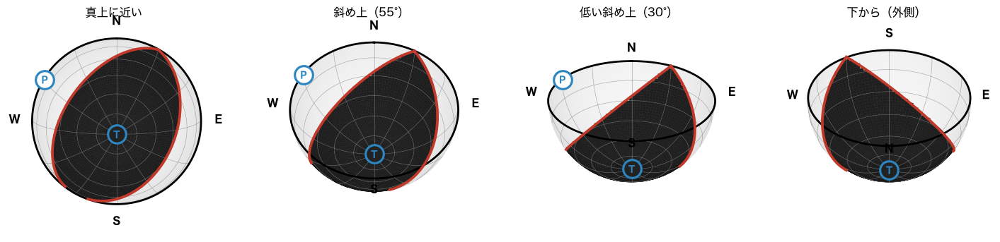

<details><summary>コード</summary>

```python
fig = plt.figure(figsize=(20, 5.5))
for i, (name, sdr) in enumerate([("正断層", presets["正断層"]), ("左横ずれ", presets["左横ずれ"]), ("斜めずれ", presets["斜めずれ"])]):
    ax = fig.add_subplot(1, 3, i + 1, projection="3d")
    render.draw_hemisphere(ax, from_sdr(*sdr), elev=40)
    ax.set_title(name, fontsize=13)
show(fig)
```

</details>

**実行結果**

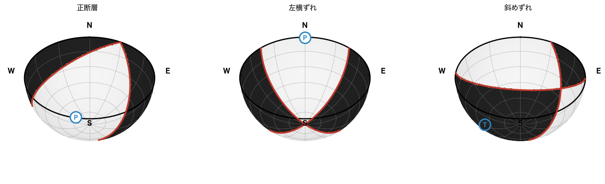

<details><summary>コード</summary>

```python
import ipywidgets as w

el = w.IntSlider(value=40, min=-80, max=89, step=5, description="見る高さ", continuous_update=False)
az = w.IntSlider(value=-90, min=-180, max=180, step=10, description="見る向き", continuous_update=False)
st = w.IntSlider(value=30, min=0, max=359, step=5, description="走向", continuous_update=False)
dp = w.IntSlider(value=45, min=1, max=90, step=1, description="傾斜", continuous_update=False)
rk = w.IntSlider(value=90, min=-180, max=180, step=5, description="すべり角", continuous_update=False)
out32 = w.Output()


def update32(_=None):
    m = from_sdr(st.value, dp.value, rk.value)
    with out32:
        out32.clear_output(wait=True)
        fig = plt.figure(figsize=(11, 5))
        render.draw_beachball(fig.add_subplot(1, 2, 1), m)
        render.draw_hemisphere(fig.add_subplot(1, 2, 2, projection="3d"), m, elev=el.value, azim=az.value, inside=el.value > 0)
        show(fig, dpi=75)


for s_ in (el, az, st, dp, rk):
    s_.observe(update32, names="value")
display(w.VBox([el, az, st, dp, rk, out32]))
update32()
```

</details>

**実行結果**

> スライダー付きのセルです。下は **初期状態** の表示（ノートブック上ではスライダーで動かせます）。

**実行結果**

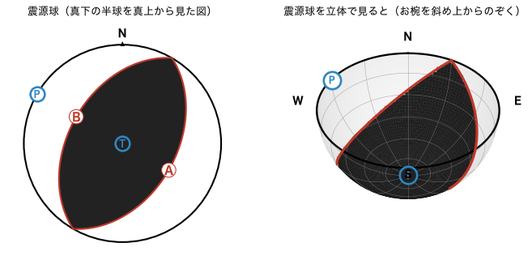

### 3-3. 平面 → お椀 → 球面を並べる

震源球が何を表しているかを、3段階で確かめる。
1. **平らな震源球**: 下半球を真上から見た円
2. **お椀**: その下半球を30°斜め上から見た立体
3. **球面の全体**: 上半球も含めた球。**上半球は下半球と点対称の同じ模様**になるので、薄く表示して区別している

確認すること: 赤線（節面）が球を一周する大円になっていること、P軸・T軸が球の反対側にも1つずつあること、
濃い下半分がそのまま②・①の絵になっていること。

<details><summary>コード</summary>

```python
mech = from_sdr(*presets["逆断層"])
out = Path("trio_preview.png")
render.render_trio(mech, out, elev=30, dpi=70)
display(Image(str(out)))
out.unlink()  # 一時ファイルを残さない
```

</details>

**実行結果**

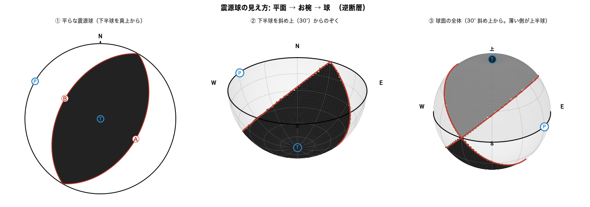

<details><summary>コード</summary>

```python
# 見る向き・高さをスライダーで変えて、球面全体を回して見る
el3 = w.IntSlider(value=30, min=-80, max=80, step=5, description="見る高さ", continuous_update=False)
az3 = w.IntSlider(value=-90, min=-180, max=180, step=10, description="見る向き", continuous_update=False)
out33 = w.Output()


def update33(_=None):
    with out33:
        out33.clear_output(wait=True)
        fig = plt.figure(figsize=(11, 5))
        render.draw_hemisphere(fig.add_subplot(1, 2, 1, projection="3d"), mech, elev=max(el3.value, 5), azim=az3.value)
        render.draw_sphere(fig.add_subplot(1, 2, 2, projection="3d"), mech, elev=el3.value, azim=az3.value)
        show(fig, dpi=70)


for s_ in (el3, az3):
    s_.observe(update33, names="value")
display(w.VBox([el3, az3, out33]))
update33()
```

</details>

**実行結果**

> スライダー付きのセルです。下は **初期状態** の表示（ノートブック上ではスライダーで動かせます）。

**実行結果**

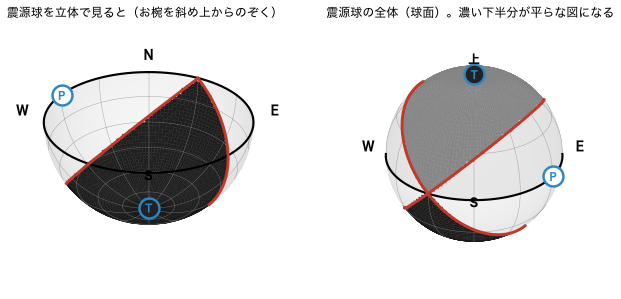

## 4. 断層ブロック図

断層面で岩盤を2つに切り、**上盤**（断層の上側＝橙）と**下盤**（下側＝青）がどう動くかを矢印で示す。
同じ震源球から、**節面Aが断層面の場合**と**節面Bが断層面の場合**の2通りが描ける。
確認すること:
- 逆断層: 橙（上盤）が上へ乗り上げる
- 正断層: 橙（上盤）がずり落ちる
- 横ずれ: 断層の向こう側が、左（左横ずれ）または右（右横ずれ）へずれる

<details><summary>コード</summary>

```python
for name in ("逆断層", "正断層"):
    mech = from_sdr(*presets[name])
    fig = plt.figure(figsize=(12, 5))
    for i, (label, plane) in enumerate((("A", mech.plane_a), ("B", mech.plane_b))):
        ax = fig.add_subplot(1, 2, i + 1, projection="3d")
        render.draw_block(ax, plane, f"{name}: 節面{label}が断層面なら\n走向{plane[0]:.0f} 傾斜{plane[1]:.0f} すべり角{plane[2]:.0f}")
    show(fig)
```

</details>

**実行結果**

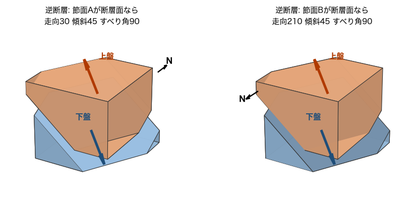

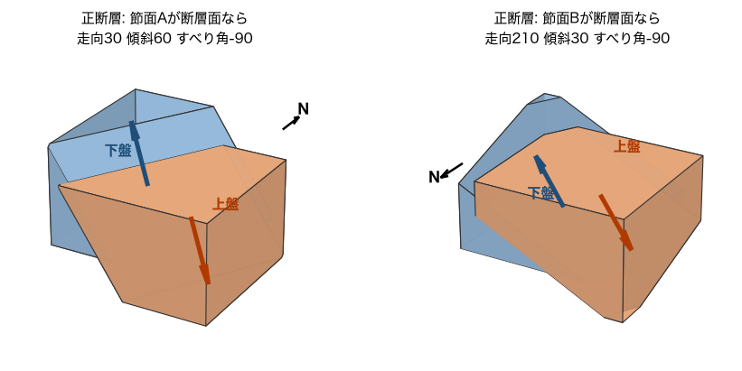

<details><summary>コード</summary>

```python
mech = from_sdr(*presets["左横ずれ"])
fig = plt.figure(figsize=(12, 5))
for i, (label, plane) in enumerate((("A", mech.plane_a), ("B", mech.plane_b))):
    ax = fig.add_subplot(1, 2, i + 1, projection="3d")
    render.draw_block(ax, plane, f"左横ずれ: 節面{label}が断層面なら")
show(fig)
```

</details>

**実行結果**

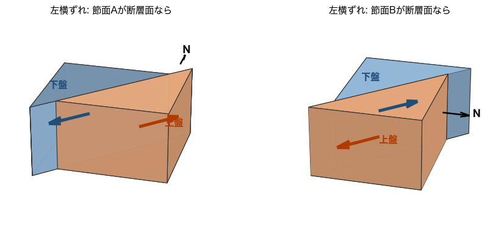

### 4-1. ブロックの切断が正しいかの数値チェック

- 上盤の全頂点が断層面の上側、下盤の全頂点が下側にある
- 切断面の頂点がすべて断層面上にある
- すべり方向は断層面の中にある（法線と直交）

<details><summary>コード</summary>

```python
for name, sdr in presets.items():
    hw, fw, cut, n, d = render._block_polys(*sdr)
    ok_hw = all(np.dot(n, p) >= -1e-9 for poly in hw for p in poly)
    ok_fw = all(np.dot(n, p) <= 1e-9 for poly in fw for p in poly)
    ok_cut = all(abs(np.dot(n, p)) < 1e-9 for p in cut)
    ok_slip = abs(np.dot(n, d)) < 1e-9
    print(f"{name:<6} 上盤={ok_hw} 下盤={ok_fw} 切断面={ok_cut} すべりは面内={ok_slip}  すべり方向の上向き成分={d[2]:+.2f}")
```

</details>

**実行結果**

```text
逆断層    上盤=True 下盤=True 切断面=True すべりは面内=True  すべり方向の上向き成分=+0.71
正断層    上盤=True 下盤=True 切断面=True すべりは面内=True  すべり方向の上向き成分=-0.87
左横ずれ   上盤=True 下盤=True 切断面=True すべりは面内=True  すべり方向の上向き成分=-0.00
右横ずれ   上盤=True 下盤=True 切断面=True すべりは面内=True  すべり方向の上向き成分=+0.00
斜めずれ   上盤=True 下盤=True 切断面=True すべりは面内=True  すべり方向の上向き成分=+0.61
```

## 5. 地表の初動マップ

震源（深さ10 km）の真上付近の地表で、P波の初動が**上向き（押し＝赤）**か**下向き（引き＝青）**かを色で示す。
震源球の黒白を、実際の地面の動きに置き換えたもの。矢印の記号は各地点の地面の動き。

<details><summary>コード</summary>

```python
fig, axes = plt.subplots(1, 3, figsize=(15, 5.2))
for ax, name in zip(axes, ("逆断層", "正断層", "左横ずれ")):
    render.draw_surface_map(ax, from_sdr(*presets[name]))
    ax.set_title(name, fontsize=13)
show(fig)
```

</details>

**実行結果**

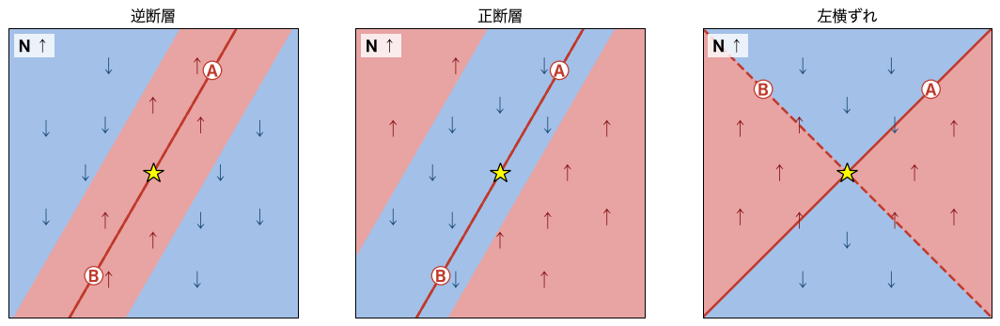

## 6. 全部入りの図

CLI と同じ、1枚にまとめた図。

<details><summary>コード</summary>

```python
mech = from_sdr(30, 45, 90)
out = Path("/tmp/beachball_decoder_nb.png") if False else Path("decoded_preview.png")
render.render_decoded(mech, out, dpi=80)
display(Image(str(out)))
out.unlink()  # 一時ファイルを残さない
```

</details>

**実行結果**

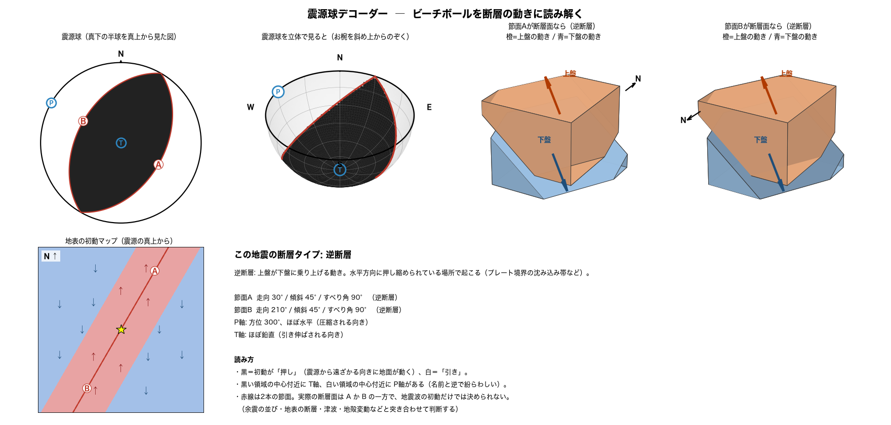

<details><summary>コード</summary>

```python
print("\n".join(render.build_summary(from_sdr(30, 45, 90))))
```

</details>

**実行結果**

```text
この地震の断層タイプ: 逆断層
逆断層: 上盤が下盤に乗り上げる動き。水平方向に押し縮められている場所で起こる（プレート境界の沈み込み帯など）。

節面A  走向 30° / 傾斜 45° / すべり角 90°   （逆断層）
節面B  走向 210° / 傾斜 45° / すべり角 90°   （逆断層）
P軸: 方位 300°、ほぼ水平（圧縮される向き）
T軸: ほぼ鉛直（引き伸ばされる向き）

読み方
・黒＝初動が「押し」（震源から遠ざかる向きに地面が動く）、白＝「引き」。
・黒い領域の中心付近に T軸、白い領域の中心付近に P軸がある（名前と逆で紛らわしい）。
・赤線は2本の節面。実際の断層面は A か B の一方で、地震波の初動だけでは決められない。
  （余震の並び・地表の断層・津波・地殻変動などと突き合わせて判断する）
```

## 7. スライダーで動かす

走向・傾斜・すべり角を動かして、震源球とブロック図がどう変わるかを見る。
**試してみること**
- すべり角を 90 → 0 → -90 と動かして、逆断層 → 横ずれ → 正断層への変化を見る
- 傾斜を 90 に近づけると、2つの節面が直交に近づく
- 節面Bの数字（補助面）が、節面Aを動かすとどう連動するか

<details><summary>コード</summary>

```python
import ipywidgets as w

strike = w.IntSlider(value=30, min=0, max=359, step=5, description="走向", continuous_update=False)
dip = w.IntSlider(value=45, min=1, max=90, step=1, description="傾斜", continuous_update=False)
rake = w.IntSlider(value=90, min=-180, max=180, step=5, description="すべり角", continuous_update=False)
out = w.Output()


def update(_=None):
    mech = from_sdr(strike.value, dip.value, rake.value)
    with out:
        out.clear_output(wait=True)
        print(f"断層タイプ: {mech.fault_type[0]}  /  節面B: 走向{mech.plane_b[0]:.0f} 傾斜{mech.plane_b[1]:.0f} すべり角{mech.plane_b[2]:.0f}")
        fig = plt.figure(figsize=(15, 4.8))
        render.draw_beachball(fig.add_subplot(1, 3, 1), mech)
        render.draw_block(fig.add_subplot(1, 3, 2, projection="3d"), mech.plane_a, "節面Aが断層面なら")
        render.draw_block(fig.add_subplot(1, 3, 3, projection="3d"), mech.plane_b, "節面Bが断層面なら")
        show(fig, dpi=70)


for s in (strike, dip, rake):
    s.observe(update, names="value")
display(w.VBox([strike, dip, rake, out]))
update()
```

</details>

**実行結果**

> スライダー付きのセルです。下は **初期状態** の表示（ノートブック上ではスライダーで動かせます）。

**実行結果**

```text
断層タイプ: 逆断層  /  節面B: 走向210 傾斜45 すべり角90
```

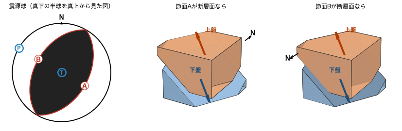

## 8. モーメントテンソルから読み解く

公開カタログ（GCMT・USGS）の形式 `Mrr Mtt Mpp Mrt Mrp Mtp`（r=上, t=南, p=東）から図にする。
下の値は**練習用の架空の値**（逆断層型）。実際の地震の値に置き換えて試せる。

> 注意: 二重couple以外の成分（CLVD・等方成分）は無視し、最も近い二重couple成分を使う。

<details><summary>コード</summary>

```python
mt = (1.7, -0.3, -1.4, 0.5, -0.2, 0.9)  # 練習用の架空の値
mech = from_mt_use(*mt)
print("判定:", mech.fault_type[0])
print("節面A: 走向%.0f 傾斜%.0f すべり角%.0f" % mech.plane_a)
print("節面B: 走向%.0f 傾斜%.0f すべり角%.0f" % mech.plane_b)
fig = plt.figure(figsize=(15, 4.8))
render.draw_beachball(fig.add_subplot(1, 3, 1), mech)
render.draw_block(fig.add_subplot(1, 3, 2, projection="3d"), mech.plane_a, "節面Aが断層面なら")
render.draw_block(fig.add_subplot(1, 3, 3, projection="3d"), mech.plane_b, "節面Bが断層面なら")
show(fig)
```

</details>

**実行結果**

```text
判定: 逆断層
節面A: 走向343 傾斜40 すべり角108
節面B: 走向139 傾斜53 すべり角75
```

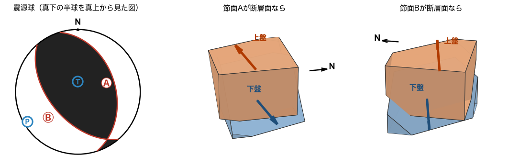

<details><summary>コード</summary>

```python
# 往復チェック: 走向・傾斜・すべり角 → テンソル → 節面 が元に戻るか
sdr = (123, 35, 40)
back = from_mt_use(*fault.ned_to_use(fault.moment_tensor(*sdr)))
print("元:", sdr)
print("復元A:", tuple(round(v, 1) for v in back.plane_a))
print("復元B:", tuple(round(v, 1) for v in back.plane_b))
```

</details>

**実行結果**

```text
元: (123, 35, 40)
復元A: (358.5, 68.4, 118.2)
復元B: (123.0, 35.0, 40.0)
```
